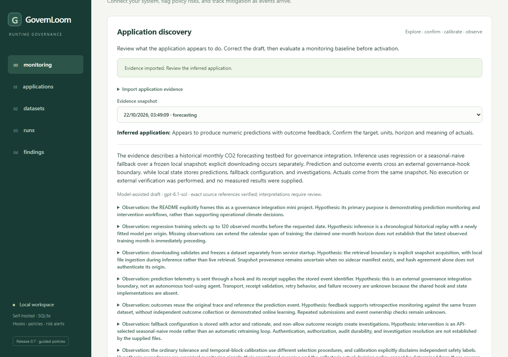

# GovernLoom

[](https://github.com/rahbarahsan/governloom/actions/workflows/checks.yml)

Explore your AI application, choose reference-backed starter policies and
track risks in operation. Vision, RAG, forecasting, classification and custom
systems share a provider-independent event contract.

Your model performs inference; GovernLoom evaluates the evidence you select.
Binary inputs and provider credentials are not automatically uploaded. Missing
evidence stays visible; a clear check is not a safety certification.

## Start from your application

```sh
governloom explore ./your-app --traces samples.jsonl --output data/discovery.json
```

Install from this checkout first. Import the reviewed bundle in the console;
GovernLoom drafts the application's behavior and telemetry mappings. Confirm or
correct them, inspect the frozen evaluation dataset and proposed thresholds, then
activate observation flags. Optional model-assisted analysis supplies referenced
hypotheses and unreviewed scenarios; code is inspected without execution.

[Discovery workflow](docs/DISCOVERY.md) · [Measured discovery evidence](docs/V06_EVIDENCE.md)



[Still preview](docs/media/demo-poster.png) · [Capture provenance](docs/media/README.md)

## Try a real incident

Install **Python 3.13+ and Node 22+**, clone this repository and run:

```sh
python scripts/quickstart.py
```

One command installs dependencies, builds the console and starts an isolated
actual digit-recognition service, named-account collector and signed receiver.
A real low-confidence prediction is withheld; a lost receipt exercises retry/
deduplication; application review, linked outcome and mitigation are recorded.
The terminal prints URLs and a private credentials-file path. **Ctrl+C stops all
owned services.** No provider key/login or paid model request is needed: the
example trains and runs a real classifier using bundled public digits.

[Quickstart](docs/QUICKSTART.md) · [Connect your own system](docs/INTEGRATIONS.md)
· [Signed incident delivery](docs/WEBHOOKS.md)

Operator actions in the GIF are scripted. Its semantic analysis is frozen real
model output; forecast inference/feedback are actual. No independent owner study
or new model request is implied by the recording.

## What ships in v0.7

- Local source/trace exploration, optional model-assisted understanding, owner
  correction, frozen evaluation sets and calibrated observation proposals.
- Reference-backed starter policies across five packs, explicit metrics and gaps,
  confirmed tool permissions, reviewable selection and documented deferrals.
- Python, native async Python and Node/TypeScript hooks, explicit observe/enforce
  behavior, linked outcomes, observation batches and selected OpenTelemetry spans.
- Policies, scoped keys, live alerts, grouped incidents and application action
  evidence with named viewer/reviewer/operator/admin access.
- Signed incident webhooks with host-controlled destinations, persisted retry,
  restart recovery, visible failures, audited replay and signing-key rotation.
- Explicit numeric outcome deadlines, restart-safe missing-feedback incidents
  and late-actual coverage that preserves the incident's review history.
- Database-plus-secret recovery bundles, conservative delivery-history retention
  and a non-root container with installed-package/restart checks in CI.
- Restart-safe metadata outbox, delivery/heartbeat coverage and reviewed grounding/
  distribution profiles with immutable provenance and explicit evidence gaps.

[Release notes](CHANGELOG.md) · [Roadmap](docs/ROADMAP.md)
· [Starter policies and metrics](docs/POLICY_CATALOGUE.md)
· [Forecast outcomes](docs/EXPECTED_OUTCOMES.md) · [Container](docs/CONTAINER.md)
· [Earlier evaluation workbench](docs/LEGACY_WORKBENCH.md)

## Evidence and limits

The original digit gate catches 17 of 18 natural errors and flags 52 correct
predictions. The new calibration-budget gate catches 15 errors and flags 26
correct predictions on the same 360 held-out cases. Confidence is not accuracy.
RAG calibration is small
and engineering-authored; source membership alone is not grounding. Historical
NOAA residuals are dependent and have no nominal false-alert guarantee.

[Launch measurements](docs/LAUNCH_EVIDENCE.md), [detector results](docs/DETECTOR_VALIDATION.md)
and [three-system evidence](docs/TESTBED_EVIDENCE.md) report denominators and limits.
[v0.5 measurements](docs/V05_EVIDENCE.md) add chronological forecast blocks,
per-label vision results, grouped source-support/retrieval gaps and a standalone
installed-wheel consumer. Its fresh Windows setup reached a real incident in
148.598 seconds; that is one owned environment, not independent user feedback.
[v0.6 measurements](docs/V06_EVIDENCE.md) demonstrate policy preparation on owned
vision/forecasting systems and an explicit RAG evidence gap. Current discovery
recipes are bounded; arbitrary risks, business tolerances and complete program
behavior cannot be inferred automatically.

[v0.7](docs/V07_EVIDENCE.md) adds reference-backed starter policies, per-control
readiness and explicit metric denominators. Owners review suggested coverage,
confirm tool permissions and select observation controls. NIST/OWASP mappings are
guidance, not certification; unavailable evaluations stay visible.

Controlled self-hosted integrations are the demonstrated scope. Production
scale/availability, tenant isolation and SSO/MFA are not established. Notification
receipt is separate from mitigation, and operator verification is an attestation.
Protect SQLite and separate signing secrets. See [access](docs/OPERATOR_ACCESS.md),
[recovery](docs/RECOVERY.md), [operations](docs/PILOT_OPERATIONS.md)
and [security reporting](SECURITY.md).

The core collector/hook supports Python 3.11+ without model dependencies.
Python and Node packages are built from this checkout; neither has been published
to a registry. No hosted deployment has occurred.

## Contribute

[Contributing and checks](CONTRIBUTING.md) · [Code of conduct](CODE_OF_CONDUCT.md)
· [Decisions](docs/DECISIONS.md) · [Resume progress](docs/PROGRESS.md)

Use issue templates for reproducible developer problems. Keep keys, private
prompts and customer data out of public reports. Original code uses
[Apache-2.0](LICENSE); [third-party attribution](docs/THIRD_PARTY.md) covers
datasets and dependencies.
