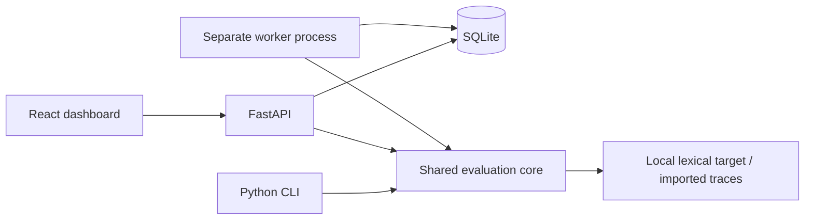

# Legacy evaluation workbench

The runtime-first quickstart is in [QUICKSTART.md](QUICKSTART.md). These instructions preserve the earlier review/evaluation and subscription-capture workflows.

## Legacy evaluation demo

1. Open **Applications**, then **Load no-key demo** to import fictional Northstar policies and 40
   unreviewed, source-verified repository fixtures. Inspect metric explanations
   and unavailable prerequisites.
2. Open **Datasets**, enter a reviewer name, inspect evidence, and edit, approve
   or reject cases. **Approve remaining** records a bulk decision by that name;
   it does not confer independent validation.
3. **Publish approved dataset**, then **Evaluate v1**. Queue a **clean** run on
   the held-out split. The worker finalizes 20 cases when all fixtures were
   approved. Open findings and unavailable checks.
4. Queue an **invalid citation** run on the same dataset and split. In **Compare
   runs**, select clean as baseline and invalid citation as candidate. Inspect
   changed citation-consistency results and highlighted source passages.
5. Try **outdated source**, **irrelevant retrieval**, **timeout**, and
   **unsupported statement**. The last demonstrates a deliberate blind spot:
   literal agreement can pass an answer with an unsupported extra claim.

Data persists in `data/governloom.db`. Restarts preserve reviews, datasets and
results. For another database, set `GOVERNLOOM_DB` to the same SQLite URL in
both API and worker terminals. Stop both processes before copying the database
and any WAL files for a backup.

The CLI accepts repository fixtures without claiming human review and runs
the same core with all five faults:

```powershell
.\.venv\Scripts\python.exe -m governloom.cli --db sqlite:///data/cli-demo.db demo
.\.venv\Scripts\python.exe -m governloom.cli --db sqlite:///data/cli-demo.db export dataset data/datasets.jsonl
```

Repeat CLI calls create a new frozen version and new runs. Repeated UI demo
loads preserve existing decisions and edits.

## Real-model capture using your ChatGPT subscription

An optional local experiment uses the installed Codex CLI's ChatGPT login to
capture actual model answers, import their traces, and evaluate them through
the existing worker. It also records exploratory claim judgments alongside
the deterministic results. You do not need to share an API key.

First confirm `codex login status` says **Logged in using ChatGPT**. Then run
from the repository root, choosing a model available to your account:

```powershell
.\.venv\Scripts\python.exe scripts/run_subscription_eval.py --allow-subscription --model gpt-6.1-sol --max-requests 8 --output data/my-subscription-capture
```

This explicitly consumes your ChatGPT/Codex allowance: four answer turns and
four judge turns. It rejects API-key authentication, removes API-key overrides
from the child environment, uses a read-only inference workspace, and rejects
captures with tool activity. Each invocation has a 180-second deadline; the
script never retries failed captures. Codex may retry network transport internally.
Normal demo, API, worker, and CI tests make no subscription calls.

The fresh output directory contains `report.json`, per-request prompts, schemas,
responses and usage, and an isolated `workbench.db`. To inspect the two imported
runs in the dashboard, set `GOVERNLOOM_DB` to that database's absolute SQLite URL
before starting the API and worker. No server is started by the capture script.

The target sees only four natural-language questions and two supplied policy
documents. It never sees reference answers or expected case labels. The second
run adds an explicitly synthetic unsupported sentence to two captured answers;
the report distinguishes those controls from observed model outputs.
Claim judgments are uncalibrated estimates in the report, not enabled dashboard
semantic scores. The corpus is fictional, fixture approvals are scripted, and
the sample is exploratory. This demonstrates real inference and exposes the
limits of literal checking; it does not establish production evaluation quality.
See [capture evidence and interpretation](SUBSCRIPTION_EVAL.md).

## Architecture and evidence



Sources retain document identity, immutable versions, SHA-256 hashes and Unicode
passage offsets. Edits create audited case revisions. Publication embeds
approved cases and all source versions in a checksummed snapshot. Runs also
freeze application/model/prompt versions, evaluator definitions, target version,
imported traces, seeded sampling and request limits.

Jobs use atomic SQLite claims, expiring leases, owner fencing, cancellation
checks, and one finalized result per run/case. A killed worker's job can be
reclaimed after its 30-second lease expires. Finalized results are preserved;
an unfinished case may execute again. The local target is read-only; arbitrary
side-effecting target calls are outside this release's scope.

See [measurement rules](MEASUREMENT.md), [schemas/imports](SCHEMAS.md),
[decisions](DECISIONS.md), and [resumable progress](PROGRESS.md).

